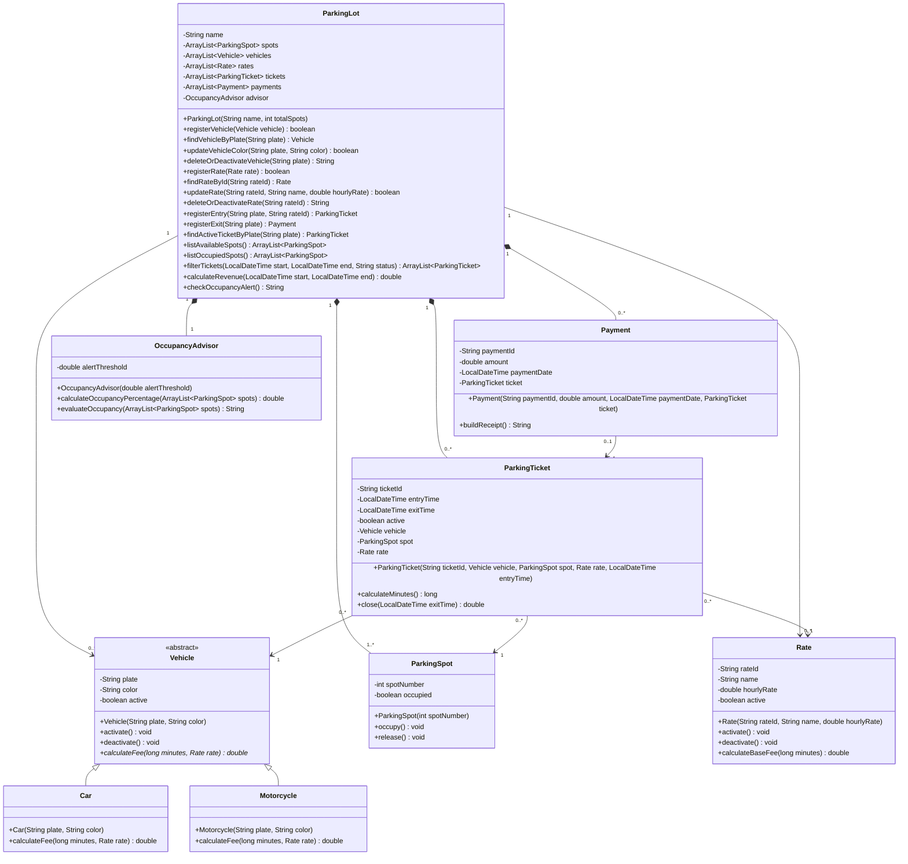

# Titulo del proyecto 
Smart Parking System

# Integrantes
Alan Gómez Ortiz
Código: 0000064873

Valeria Alexandra Claro Vargas
Código: 0000064015

# Descripción general del sistema
Aplicación para el personal de un parqueadero que necesita conocer la ocupación durante la jornada y cobrar al finalizar cada estancia. El sistema vincula cada ingreso con su salida para que el operador pueda consultar los cupos disponibles y revisar la actividad del parqueadero.

# Instrucciones para ejecutar
# Ejemplo de entrada/salida
# Diagrama de clases

