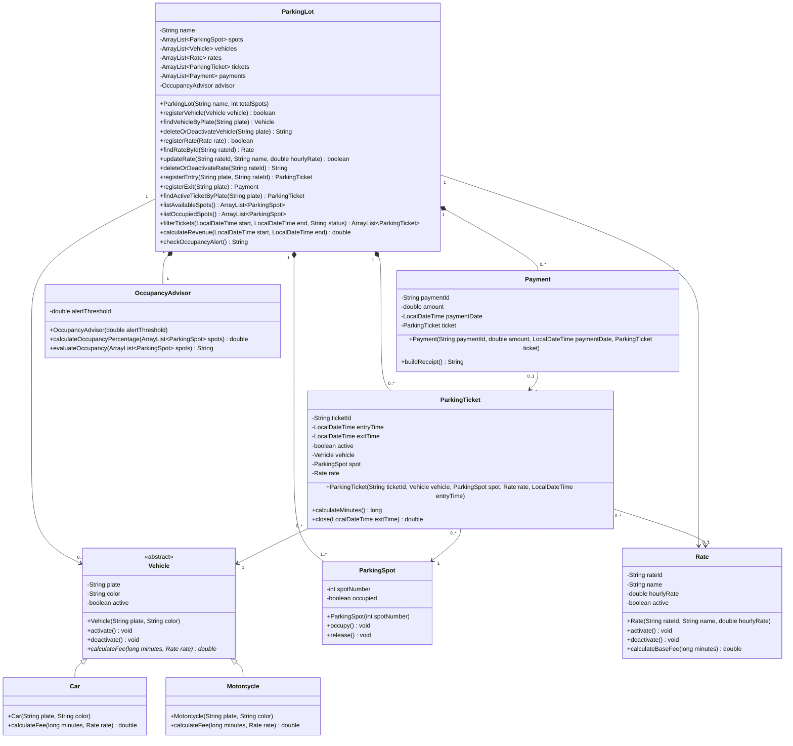

# Titulo del proyecto 
Smart Parking System

# Integrantes
Alan Gómez Ortiz
Código: 0000064873

Valeria Alexandra Claro Vargas
Código: 0000064015

# Descripción general del sistema
Aplicación para el personal de un parqueadero que necesita conocer la ocupación durante la jornada y cobrar al finalizar cada estancia. El sistema vincula cada ingreso con su salida para que el operador pueda consultar los cupos disponibles y revisar la actividad del parqueadero.

## Entidades administrables (CRUD) y reglas del negocio
- **Vehículos (`Vehicle` / `Car` / `Motorcycle`):**
  - Permite registrar, buscar por placa exacta y listar.
  - **Restricción de eliminación:** Solo se puede eliminar físicamente si el vehículo no tiene tiquetes asociados. Si ya cuenta con historial de movimientos, se desactiva (`active = false`) para conservar la trazabilidad y no puede volver a ingresar mientras esté inactivo. Tampoco se permite eliminar ni desactivar mientras tenga un ingreso activo.
- **Tarifas (`Rate`):**
  - Permite registrar, buscar por ID, listar y modificar el nombre y valor por hora.
  - **Regla de modificación:** Los cambios en el valor por hora aplican a nuevos ingresos y a tiquetes que aún sigan activos al momento de calcular la salida. Los pagos ya generados conservan su monto original.
  - **Restricción de eliminación:** Solo se elimina si no está asociada a ningún tiquete; si tiene historial, se desactiva (`active = false`).
- **Registros históricos (`ParkingTicket` y `Payment`):**
  - No permiten edición ni eliminación libre. Los tiquetes solo pasan de estado activo a cerrado al registrar una salida válida, generando un pago inmutable que conserva el historial financiero.

# Instrucciones para ejecutar
1. Abrir la carpeta raíz del proyecto en Visual Studio Code.
2. En el explorador de archivos de la izquierda, navegar a la ruta `src/ui/` y abrir el archivo `Main.java`.
3. Hacer clic en el botón de "Play" (Run Java) ubicado en la esquina superior derecha del editor.
4. El programa se iniciará y podrá interactuar con el menú principal directamente desde la consola del editor.

# Ejemplo de entrada/salida

# Diagrama de clases

